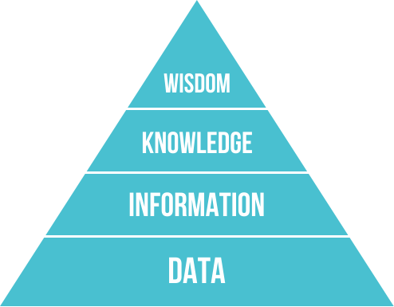
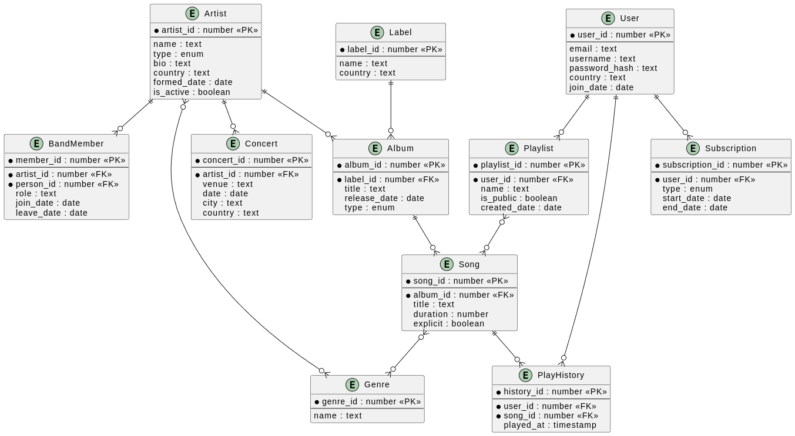
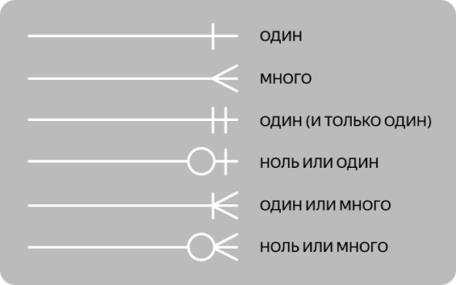

По мере развития и распространения ЭВМ, роста объемов информации, которыми они должны были оперировать, появилась необходимость в функциональном хранилище данных, которое бы обладало устойчивой структурой, позволяло пользователю получать доступ к необходимым записям, администратору - управлять правами доступа пользователей, поддерживало бы операции манипуляции данными.

Так возникли базы данных.

## DIKW

База данных хранит в себе однотипные записи. Для понимания того, как извлекать из них смысл была придумана иерархическая модель **DIKW(Data - Information - Knowledge - Wisdom)**



- **Данные (data)** - сырые, необработанные факты
- **Информация (inforamtion)** - к данным добавляется контекст
- **Знание (knowledge)** - информация, объединенная с опытом, объясняет "как" и "почему это работает"
- **Мудрость (wisdom)** - добавляются условия использования, "что лучше всего сделать в будущем"

*Пример:* 

`данные` - простой набор чисел 37, 36.6, 38.5 -> <br>`информация` - это теммпература тела пациентов -> <br> `знание` - кто-то из них недавно заболел, кто-то здоров, у кого-то жар -> <br>`мудрость` - одного мы выпишем, другому дадим чай, третьему жаропонижающее

## Требования к базам данных

Выше мы говорили о функциях, которыми должна обладать база данных, сформулируем их более конкретно:

- **Структура данных** - должен быть определен спобов хранения файлов, записей и полей, представление символьных, числовых данных
- **Язык запросов** - должен быть определен интерфейс доступа к данным, с помощью которого реализуются операции
- **Совместный доступ к данным** - сокращение *избыточности* данных, устранение *противоречивости* данных, возможность поддержки *транзакций*

---

**Противоречивость данных** - существование двух или более фактов, логически исключающих друг друга

**Избыточность данных** - ситуация, когда одно и то же свойство сущности (или связь) может быть выведено из других данных в этой же базе данных

**Транзакция** - логическая единица работы базы данных, включающая несколько операций, выполняющихся одновременно и совместно откатываемых в случае ошибки

---

- **Обеспечение целостности данных** - наложение *ограничений целостности (integrity constraints)*, которые будут применяться при любой попытке изменения данных. 
---

**Целостность данных** -  свойство, обеспечивающее соответствие данных внутренней логике и правилам системы, предотвращая появление бессмысленных или противоречивых значений

---

- **Защита данных** - наложение ограничений защиты (security constraints), которые будут применяться при любой попытке доступа к конфиденциальным данным
- **Независимость от данных** - невосприимчивость приложений к изменениям в физическом представлении данных *(физическая независимость)* и в методах доступа к ним *(логическая независимость)*

---

Из требований следует, что мы хотим получить клиент-серверную архитектуру, состоящую из физического хранилища (непосредственно базы данных) и пользовательского интерфейса доступа (СУБД).

Определения этих компонент по Дейту звучат так:

> **База данных** - набор постоянно хранимых данных, используемых прикладными системами предприятия

> **СУБД (система управления базами данных)** - ПО, с помощью которого пользователи могут определять, создавать и поддерживать базу данных, а также осуществлять контролируемый к ней доступ

На практике, когда говорят "база данных", часто подразумевают именно СУБД.

## Архитектура ANSI/SPARC

Чтобы удовлетворять требованиям, СУБД должна реализовывать конкретную абстракцию. Такая абстракция называется моделью данных.

> **Модель данных** - абстрактное, самодостаточное, логическое определение объектов, операторов и прочих элементов, составляющих в совокупности интерфейс доступа к данным, с которым взаимодействует пользователь, позволяющее моделировать структуру и поведение данных.

Для моделирования СУБД была разработана специальная архитектура ANSI/SPARC, включающая в себя три уровня.

---

**Логический (внешний)** - способ представления данных для отдельных пользователей, определяет язык запросов и конкретные структуры данных, которые будут реализовывать абстракции концептуального уровня

---

**Концептуальный** - способ обобщенного представления данных, определяет общую бизнес-логику: сущности, свойства связи между ними (промежуточный уровень)

---

**Физический** - способ сохранения информации на физических устройствах, определяет подсистемы хранения данных: типы данных дисковой памяти, индексы, физическое размещение

---


Есть множество различных моделей данных: реляционная, документориентированная, графовая и т.д. Все кроме реляционной мы разберем подробнее позже.

Важно отличать модель данных от ее реализации - физического воплощения, реализующего модель. 

*Пример:*

Модель: `Реляционная` <br>
Реализации: `PostgreSQL`, `MySQL`, `SQLite`

## Реляционные базы данных

### Отношения

Реляционная база данных состоит из **переменных отношения (relvar)**, значениями которых являются **отношения (relation)** или, менее формально, таблицы. Строки таблицы называются **кортежами**, а стобцы - **атрибутами**. Количество атрибутов отношения называется его **степенью**. Множество значений атрибута называется **доменом**.

---

**Переменная отношения** - это таблица с точки зрения структуры: схема (заголовок), наложенные ограничения (constraints), ее набор строк может изменяться со временем при выполнении операций.

  - Базовые (base relvars) - переменные, соответствующие реальным таблицам в базе данных
  - Производные (derived relvars) - *представления (view)* или результаты запросов, значение которых вычисляется на основе других переменных-отношений


  > **Представление** - виртуальная таблица, которая не хранит физически данные на диске, а представляет собой сохраненный SQL-запрос к одной или нескольким реальным таблицам


**Значение отношения** - непосредственно набор кортежей в конкретный момент времени.

---

### Ключи

Для того, чтобы отличать строки друг от друга, не сравнивая значения их атрибутов, необходим уникальный идентификатор строки. Такой идентификатор называется **первичным ключом**. Дадим ему определение через другие типы ключей.

**Суперключ** - подмножество атрибутов отношения, значения которых уникальны для кажой его строки

**Потенциальный ключ** - минимальный суперключ

> **Первичный ключ (primary key / PK)** - выбранный потенциальный ключ (потенциальных ключей может быть несколько, невыбранные называются альтернативными)

*Пример:*

`Отношение:` Студенты <br>
`Набор атрибутов:` Номер ИСУ, Серия и номер паспорта, Фамилия, Имя <br>
`Суперключи (не все):` {Номер ИСУ, Серия и номер паспорта}, {Серия и номер паспорта, Фамилия}, {Номер ИСУ, Имя}, {Серия и номер паспорта} <br>
❗️ Важно ❗️ {Фамилия, Имя} - **не суперключ**, потому что существуют полные тезки. <br>
`Потенциальные ключи:` {Номер ИСУ}, {Серия и номер паспорта} <br>
`Первичный ключ:` пусть мы выбрали {Номер ИСУ}

Отношения иногда нужно связывать, например, мы добавили отношение `Дисциплины`, в котором хотим хранить информацию о выбранных студентами дисциплинах. В такой ситуации нам понадобится **внешний ключ**.

> **Внешний ключ (foreign key / FK)** - атрибут или группа атрибутов одного отношения, которые ссылаются на первичный ключ другого отношения.

Внешние ключи используются для связей отношений.

### Связи

В базе данных множество отношений, для визуализации связей между ними используют **ER-диаграммы (Entity-Relationship Diagram / Диаграмма Сущность-Связь)**.

*Пример:*



Как мы видим отношения друг с другом связывают линии со странным кружочками и черточками, так харатеризуются *типы связи* в нотации "Воронья лапка".

*Условные обозначения в нотации:*



### Типы связи

- **1 <-> 1 (One-to_One / Один-к-Одному)** <br>
Отношение `Users`, PK `User_ID` | Отношение `Profiles`, PK `Profile_ID`, FK `User_ID`

- **1 <-> N (One-to-Many / Один-ко-Многим)** <br>
Отношение `Customers`, PK `Customer_ID` | Отношение `Orders`, PK `Order_ID`, FK `Customer_ID`

- **M <-> N (Many-to-Many / Многие-ко-Многим)** <br>
Реализуются не напрямую, а через промежуточную таблицу связей, получая два 1 <-> N:<br>
Отношение `Books`, PK `Book_ID` | Отношение `Books_Authors`, PK FK `Book_ID`, PK FK `Author_ID` | Отношение `Authors`, PK `Author_ID`

## Язык запросов SQL

Одним из требований к базе данных был язык запросов, в реляционных база данных это **SQL (Stuctured Query Language)**. 

### Типы данных

SQL определяет следующие типы данных:


**1. Числовые типы (Numeric)**

Используются для хранения целых и дробных чисел:
- Целые числа:
	- `TINYINT` - от 0 до 255 (занимает 1 байт).
	- `SMALLINT` - от -32 768 до 32 767 (2 байта).
	- `INT (или INTEGER)` - от -2.1B до 2.1B (4 байта).
	- `BIGINT` - очень большие целые числа (8 байт).
- С фиксированной точкой (денежные и точные расчеты):
	- `DECIMAL` / `NUMERIC` - точные числа с заданной точностью и масштабом (например, `DECIMAL(10, 2)`).
	- `MONEY` / `SMALLMONEY` - для хранения денежных значений.
- С плавающей точкой (приближенные):
	- `FLOAT` / `REAL` - для научных и инженерных расчетов с большой погрешностью в мантиссе.

**2. Строковые типы (String / Character)**

Используются для хранения текста:
- `CHAR(n)` - строки фиксированной длины (дополняются пробелами до n).
- `VARCHAR(n)` - строки переменной длины (занимают ровно столько места, сколько символов внутри + служебные байты).
- `TEXT` - большие объемы текстовой информации (в современных СУБД часто заменяется на VARCHAR(MAX)).
- Юникод (для поддержки разных алфавитов, включая кириллицу и иероглифы):
	- `NCHAR(n)` и `NVARCHAR(n)` (занимают по 2 байта на символ).

**3. Типы даты и времени (Date & Time)**

Используются для работы с временными метками:
- `DATE` — только дата (год, месяц, день).
- `TIME` — только время (часы, минуты, секунды).
- `DATETIME` — дата и время вместе.
- `TIMESTAMP` — момент времени
- `TIMESTAMPZ` - `TIMESTAMP` с указанием часового пояса

**4. Логический тип (Boolean)**

- `BOOLEAN` — хранит значения истины.

**5. Двоичные типы (Binary)**

Используются для хранения сырых байтов, файлов, изображений:
- `BINARY(n)` / `VARBINARY(n)` — двоичные данные фиксированной или переменной длины.
- `BLOB (Binary Large Object)` / `IMAGE` — для больших бинарных объектов.

**6. Специальные типы**

- `JSON` / `XML` — для хранения структурированных документов.
- `UUID` — уникальные идентификаторы (например, 123e4567-e89b...).
- `GEOMETRY` / `GEOGRAPHY` — пространственные данные (координаты, карты).
- Отдельно остановимся на типе `NULL` - маркерном значении, обозначающем отсутствие данных или неизвестное значение в ячейке таблицы. <br>
Он не равен ни нулю, ни пустой строке, ни даже самому себе (выражение `NULL = NULL` не даст `TRUE`, так же как и `NULL != NULL`). Для проверки на `NULL` используются операторы `IS NULL` и `IS NOT NULL`. <br>
Часто на атрибут накладывается `NOT NULL` ограничение, когда поле критически важно по смыслу, чтобы не нарушать целостность данных. Например, первичный ключ не может быть пустым по определению.

---

### Операторы

Язык должен определять операторы, операторы в SQL делятся на четыре основных подмножества:

- **DDL (Data Definition Language)** — управление структурой базы данных (`CREATE`, `ALTER`, `DROP`, `RENAME`).

- **DML (Data Manipulation Language)** — работа с данными внутри таблиц (`SELECT`, `INSERT`, `UPDATE`, `DELETE`).

- **DCL (Data Control Language)** — настройка прав доступа и безопасности (`GRANT`, `REVOKE`).

- **TCL (Transaction Control Language)** — управление транзакциями (`COMMIT`, `ROLLBACK`, `SAVEPOINT`).

Подробнее поговорим про оператор `SELECT`, который нужен для получения **выборки** - подмножества кортежей отношения. Как следует из названия языка, запросы в нем имеют особую устойчивую структуру:

```SQL
[ WITH [ RECURSIVE ] cte_name ( [ column_name [, ...] ] ) AS ( (query) ) [, ...] ]
SELECT [ ALL | DISTINCT [ ON ( expression [, ...] ) ] ]
       { * | expression [ [ AS ] output_name ] } [, ...]
[ INTO [ TEMP | TEMPORARY | UNLOGGED ] [ TABLE ] new_table ]
[ FROM from_item [, ...] ]
[ WHERE condition ]
[ GROUP BY [ ALL | DISTINCT ] grouping_element [, ...] ]
[ HAVING condition ]
[ WINDOW window_name AS ( window_definition ) [, ...] ]
[ { UNION | INTERSECT | EXCEPT } [ ALL | DISTINCT ] select ]
[ ORDER BY expression [ ASC | DESC ] [ NULLS { FIRST | LAST } ] [, ...] ]
[ LIMIT { count | ALL } ]
[ OFFSET start ]
[ FETCH { FIRST | NEXT } [ count ] { ROW | ROWS } [ ONLY | WITH TIES ] ]
```

При этом порядок исполнения операций SELECT-запроса отличается от порядка их написания:

```SQL
1. FROM - выбирается таблица
2. WHERE - отбираются строки, подходящие под условие
3. GROUP BY - выполняется группировка
4. HAVING - отбираются группы, подходящие под условие
5. SELECT - выбираются нужные для вывода атрибуты
6. ORDER BY - строки сортируются в соответствии с условием
7. LIMIT - остается фиксированное количество строк
